# 得律AI

得律AI 是一套面向法律信息检索与辅助研究的智能服务系统。电脑端可以注册登录、发起法律咨询、管理会话和公告；商业版在此之上提供检索、合同、文书、律师、语音视频、企业协作、会员支付，以及手机端、微信小程序、抖音小程序和 Android / iOS。

本仓库是 **社区版** 源码，以 [GNU Affero General Public License v3.0](LICENSE) 授权。社区版是开源法律咨询，AI法律工具，以及与咨询对应的管理后台和后端。商业版源码只在本地维护。

「得律AI」名称和 Logo 不随这份代码许可授权，见 [TRADEMARK.md](TRADEMARK.md)。

## 关键词

法律咨询、法规检索、案例检索、合同审查、文本阅读、文书生成、类案分析、法律工具、律师、企业法务、语音咨询、视频咨询、开源、法律AI、FastAPI、Vue。

这些词是用户寻找法律智能工具时会用的检索词。本仓库是开源法律咨询，AI法律工具；法规检索、合同、文书、律师、语音视频和企业法务在商业版演示中。

## 商业版演示

社区版可以在本机用 Docker 跑起来。下面两个地址是已经上线的商业版，用来看完整产品效果：

| 端 | 地址 |
| --- | --- |
| 电脑端 | https://law.asiplatforms.com |
| 移动端 | https://h5.asiplatforms.com |

## 两个版本对照

| | 社区版（本仓库） | 商业版（本地，见上方演示） |
| --- | --- | --- |
| 客户端 | 电脑端 | 电脑端、手机网页、微信小程序、抖音小程序、Android、iOS |
| 账号 | 注册、登录、找回密码 | 同上，并增加微信、抖音登录 |
| 法律咨询 | 多轮对话、会话列表、咨询附件、对话分享 | 同上，并增加深度思考、联网检索、语音播报 |
| 模型 | 管理端填写自己的对话模型密钥 | 平台统一接入，并按套餐控制额度 |
| 额度 | 本机按自然日计数，默认每天 5 次，可用 `FREE_DAILY_CHAT_QUOTA` 调整 | 积分、余额、会员套餐和订单 |
| 内容 | 平台公告、用户协议、隐私政策、关于我们、联系我们 | 同上，并增加启动页、运营海报 |
| 个人中心 | 资料、账号安全、消息通知、咨询记录 | 同上，并增加钱包、订单、会员、积分、用量 |
| 管理后台 | 概览、用户、角色、公告、法律页面、会话、反馈、审计、站点与上传配置、登录安全、通用对话模型、咨询用量 | 同上，并增加套餐、订单、账单、企业、推送、文书模板、检索 / 合同 / 律师 / 音视频配置、开放 API、支付与音视频接入 |
| 法律能力 | 法律咨询 | 法规案例检索、文本阅读、合同审查、合同抽取、文书生成、类案分析、律师服务、语音、视频、电子签署、企业法务工作台 |
| 数据与任务 | PostgreSQL、Redis | 同上，并增加 Elasticsearch、Celery 定时任务 |
| 部署单元 | 数据库、Redis、后端、用户端、管理端 | 同上，并增加检索、手机端、异步任务、推送 |

## 社区版功能

### 电脑端

用户打开用户端即可注册。登录后进入法律咨询：输入问题，模型按多轮会话回答；会话可以回看、继续和分享。咨询里可以上传附件。首页和咨询页展示平台公告。

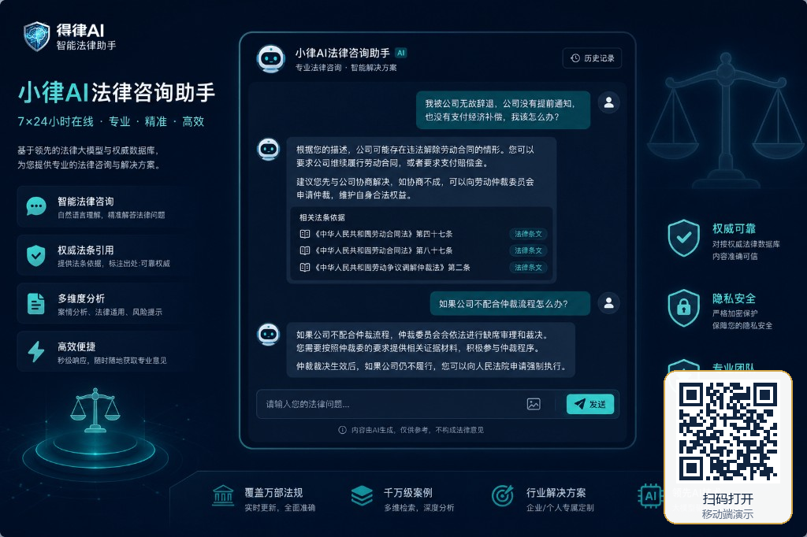

个人中心包含四项：

- 个人资料
- 账号安全（修改密码）
- 消息通知
- 咨询记录

### 管理后台

管理员使用 `.env` 里的初始账号登录管理端，可以：

- 查看概览
- 管理用户和角色
- 发布公告，编辑用户协议、隐私政策、关于平台、联系我们
- 查看咨询会话和用户反馈
- 查看审计记录
- 配置站点信息、上传、缓存、登录安全
- 在「对话模型」里填写自己的模型地址和密钥
- 查看咨询用量

社区版不代管模型密钥。把密钥填进管理端之后，用户端咨询才会真正调用模型。

### 后端

接口覆盖注册登录、用户资料、会话、咨询对话、附件、公告与法律页面、公开配置，以及上面列出的管理接口。咨询次数记在本机用量日志里，按自然日累计，默认上限 5 次。

运行依赖 PostgreSQL 和 Redis。检索索引、支付、会员、积分和企业数据不在社区版里建表。

## 商业版功能

商业版演示站已经包含下面这些能力。截图来自产品效果图和移动端界面，源码不在本仓库。

### 法规案例检索、合同、文书和类案

电脑工作台可以查法规和裁判案例、审查合同、生成文书、做类案分析。

| 法规案例检索 | 合同审查 |
| --- | --- |
| 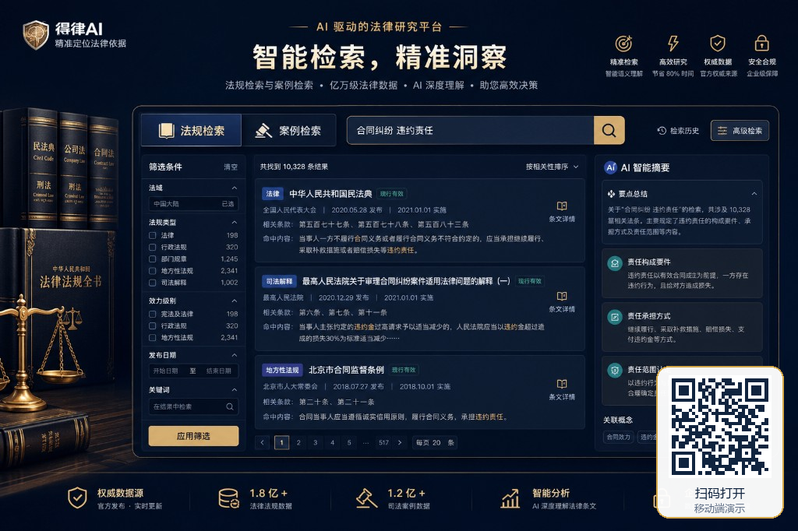 | 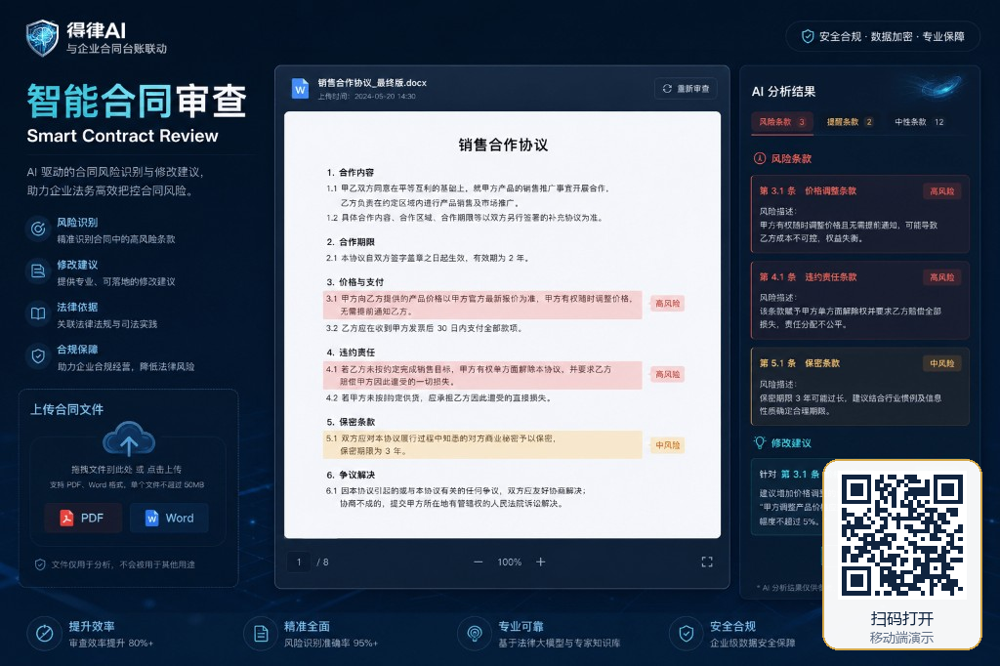 |
| 文书生成 | 类案分析 |
| 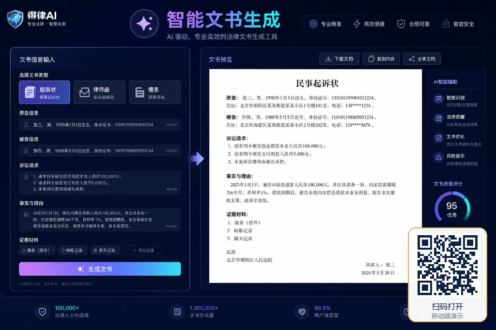 | 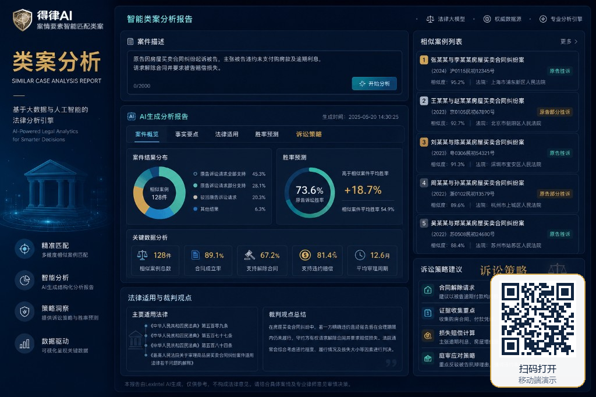 |

### 企业法务与多模态

企业工作台把咨询、合同和文书收进组织协作。语音和视频用于咨询过程中的多模态交互。

| 企业法务工作台 | 多模态交互 |
| --- | --- |
| 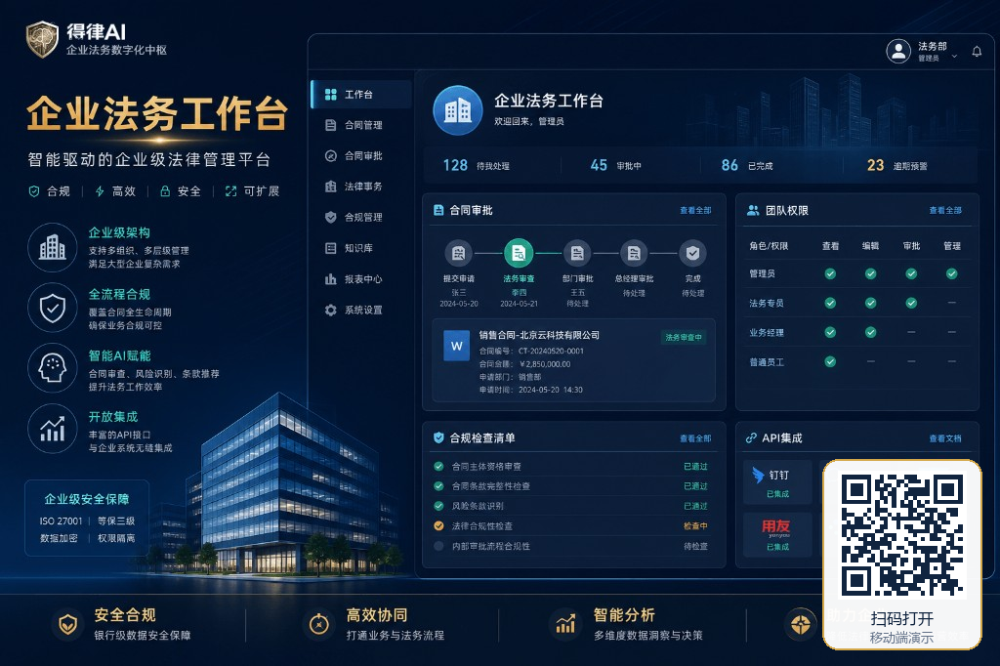 |  |

### 移动端

手机网页、微信小程序、抖音小程序和 Android / iOS 与电脑端共用同一套商业能力：咨询、检索、合同、文书、律师、语音视频、企业和会员。

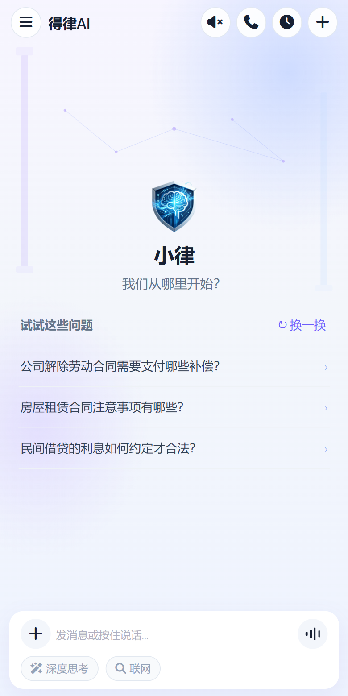

| 咨询 | 检索 | 合同 |
| --- | --- | --- |
| 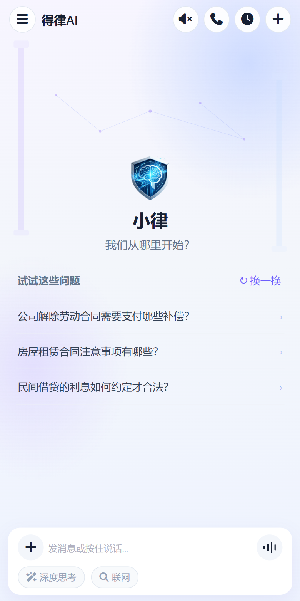 | 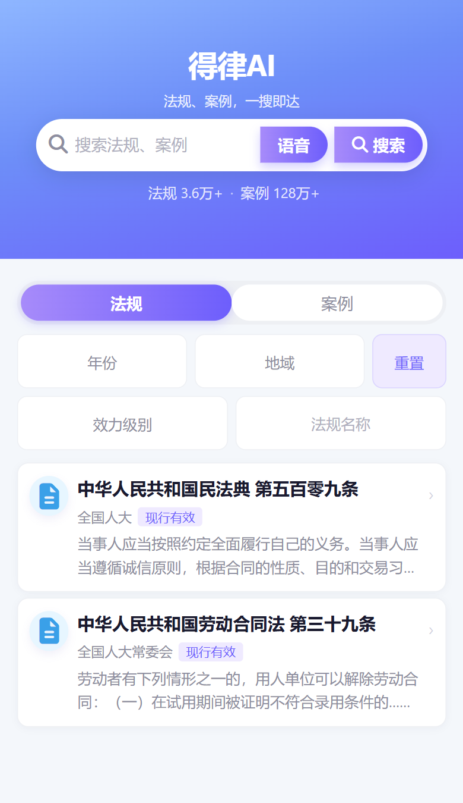 | 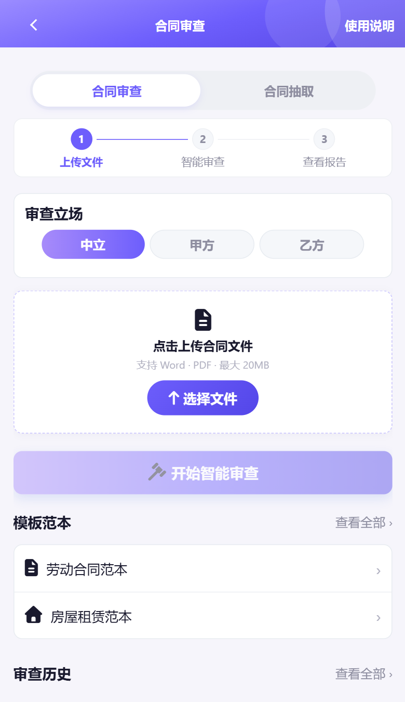 |
| 文书 | 律师 | 语音视频 |
| 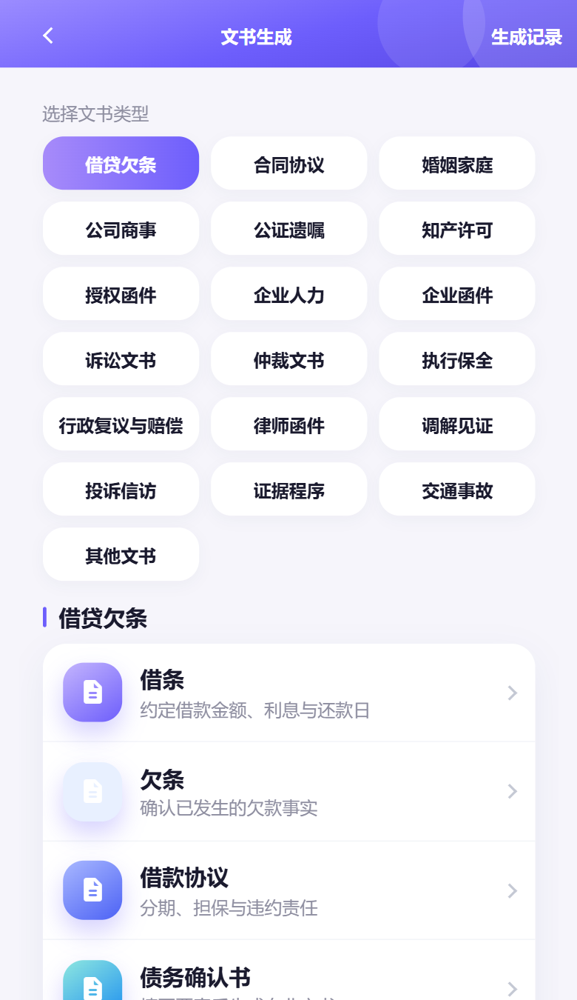 | 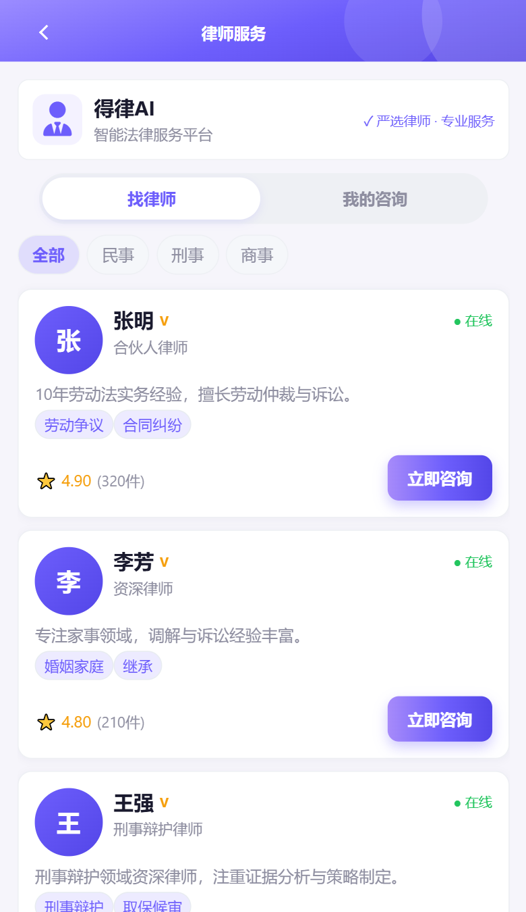 | 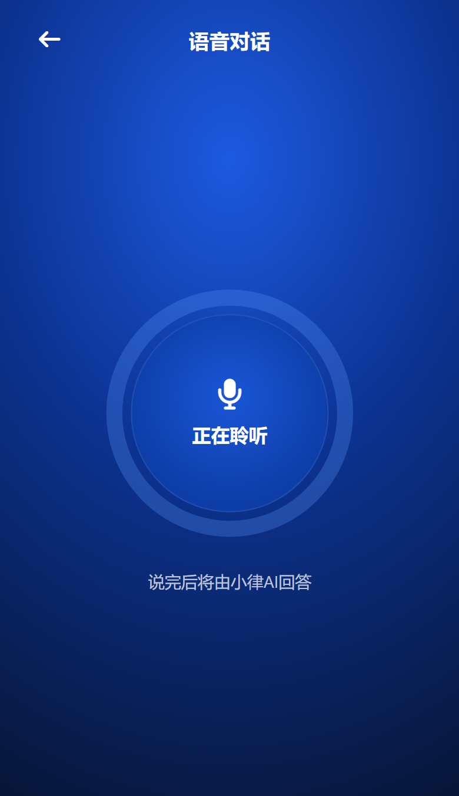 |
| 企业 | 登录 | 会员 |
| 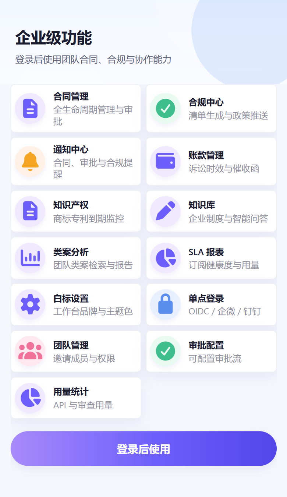 | 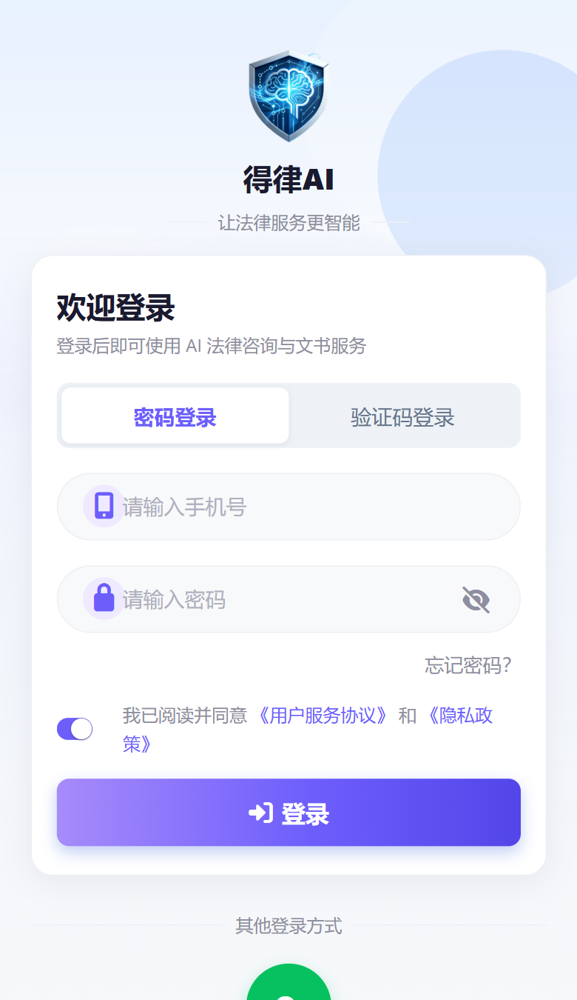 | 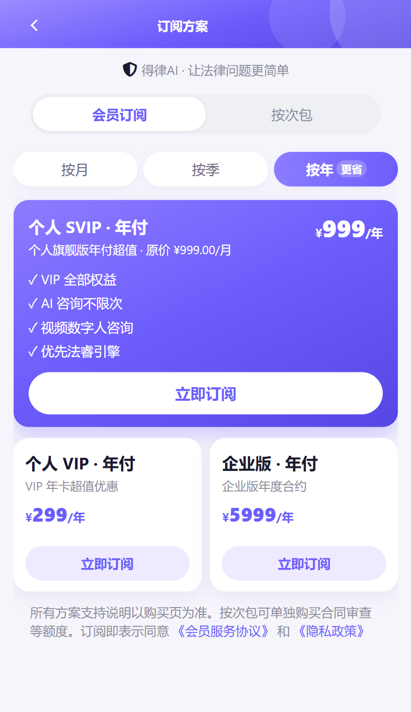 |

商业版管理端另外包含套餐与订单、账单、企业组织、消息推送、文书模板、检索 / 合同 / 律师 / 音视频配置、开放 API，以及微信支付、支付宝和音视频服务的接入配置。

## 本地运行

需要本机已安装 Docker。

```bash
cp .env.example .env
docker compose up --build
```

| 服务 | 地址 |
| --- | --- |
| 用户端 | http://localhost:8080 |
| 管理端 | http://localhost:8081 |
| 接口 | http://localhost:8000 |

首次启动后执行：

```bash
docker compose exec backend alembic upgrade head
```

这条迁移只创建社区版数据表。

管理端进入「对话模型」，填入自己的模型密钥。`.env` 里的 `FREE_DAILY_CHAT_QUOTA` 默认是 5。`ADMIN_BOOTSTRAP_PASSWORD` 请改成自己的管理密码。

## 许可

代码以 GNU Affero General Public License v3.0 授权，见 [LICENSE](LICENSE)。

通过网络提供修改后的社区版时，需要向用户提供对应源码。「得律AI」文字、Logo 和相关标识不在这份许可之内，再分发时请换用自己的名称和标识，并保留 [TRADEMARK.md](TRADEMARK.md) 与 LICENSE。

咨询回答仅供法律信息参考，不构成律师意见或法律意见。

## 开源交流

官方 QQ 群：**398903956**

扫码加入得律AI官方群。

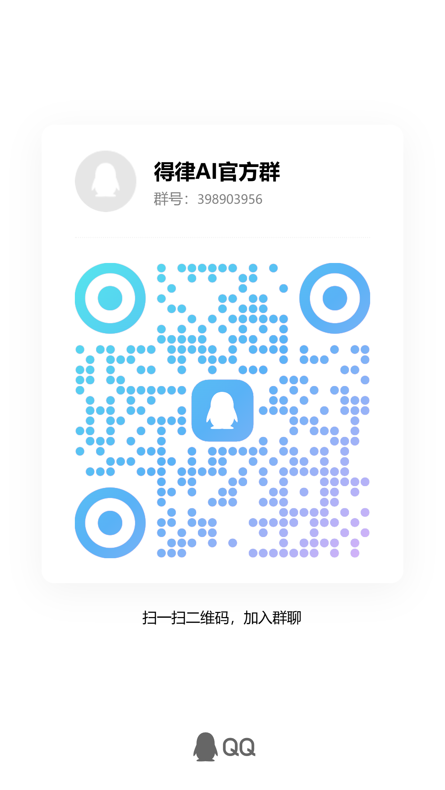

## 赞赏

社区版如果对你有帮助，欢迎赞赏。

| 微信 | 支付宝 |
| --- | --- |
|  |  |
